# Abstract

Longitudinal omics studies measure the same biological unit repeatedly, but many standard analyses first flatten the data into a two-dimensional matrix. This report re-analyses two public longitudinal transcriptomic datasets with the tensorOmics framework (tensor PCA, tensor PLS, tensor PLS-DA and their multi-block extensions) and adds an explicitly defined validation layer: subject-level permutation tests, a structure-preserving time reshuffle, subject-grouped cross-validation, nested batch audits, robustness grids and power analysis. The first dataset (GSE150318) contains fin RNA-seq trajectories from the short-lived killifish *Nothobranchius furzeri* sampled at 10 and 20 weeks of age and related to age at death (113 fish). A supervised tensor PLS-DA on the median lifespan split was reproduced exactly (Pillai's trace = 0.446); a structure-preserving time reshuffle (p = 0.150) shows that the signal is level-based rather than change-based (10w+20w levels R² = 0.541; adding the 10-to-20-week change does not improve the model). Annotation closure mapped all analysed genes and surfaced a coherent circadian-clock module (7/8 core clock genes FDR-significant, direction-consistent), while the mitochondrial complex I theme of the original study was recovered only as a diffuse 1.60× enrichment. Out-of-sample performance decayed as expected (subject-grouped LOSO R² ≈ 0.31; a ridge baseline matched it), so the data support a replicated *association*, not prediction or mechanism. The second dataset (GSE79396) contains early PBMC transcriptomes after Zostavax vaccination in 72 young and elderly adults (days 0/1/3/7). Here the tensor view quantifies two classical matrix-analysis failure modes: pseudo-replication (matrix PLS-DA permutation p = 0.002 with naive row shuffling versus p = 0.094 with subject-level shuffling) and leakage in cross-validation (row-level LOSO balanced accuracy 0.722 versus 0.644 for subject-grouped LOSO; the subject-grouped tensor model achieves 0.685). A nested batch audit then shows that the apparent age axis of this dataset is inseparable from processing-plate structure: after plate-level correction the age association collapses (permutation p = 0.003 → 0.18), the previously reported inflammaging panel loses significance, no blood transcription module survives correction, and the multi-block shared axis (r = 0.83) falls to 0.44 and aligns with none of the age labels. Overall, the tensor representation puts the subject back at the centre of the analysis and enables batch and integration workflows that matrix views obscure; the validation layer is what separates a defensible conclusion from a confounded or over-confident one. The main biological conclusions are a level-based, module-organised lifespan association in killifish fin transcriptomes, and the non-recoverability of a batch-independent transcriptomic age axis in the vaccine dataset.

# 1 Introduction

Longitudinal omics data are naturally multi-way: subjects × molecular features × time. A common workaround is to flatten everything into a matrix, either by treating every sample-time observation as an independent row or by concatenating time points into a wide feature table. Both remain useful, but the statistical object no longer matches the experimental unit, and repeated measurements are silently converted into pseudo-replications.

Tensor methods keep the multi-way structure during dimension reduction. The tensorOmics framework [1] provides five methods for longitudinal omics data — tensor PCA (tPCA), tensor PLS (tPLS, canonical or regression mode), tensor PLS-DA (tPLS-DA), block tensor PLS (block.tPLS) and block tensor PLS-DA (block.tPLS-DA) — built on a tensor-tensor algebra with an invertible transform (discrete cosine transform, DCT), a subject-wise mean-deviation centring (MDF) and component extraction by a tensor-adapted NIPALS scheme built on the tensor SVD (t-SVDM2) decomposition [1]; the released package performs the corresponding component updates via tensor SVD factorisations with component-wise deflation (Section 3.3). Related work by Mor et al. [2] argues the same rationale. The methods paper demonstrates these tools on three case studies (antibiotic perturbation, anaerobic digestion, faecal microbiota transplantation) and shows two characteristic advantages: subject-level trajectory scores that respect repeated measures, and supervised discriminant components that separate groups when inter-individual variability dominates.

The methods paper does not, however, provide an inferential framework: it reports no p-values, no cross-validation and no permutation tests, and its validation is based on visual separation and on the biological plausibility of the top features. Any application therefore needs its own audit layer. That observation defines the contribution of this internship report.

This report re-analyses two public longitudinal transcriptomic datasets with the official tensorOmics package and asks three questions:

1. Do tensor components recover biologically interpretable structure that matrix analyses miss or distort?
2. Under which inference protocols (permutation schemes, cross-validation splits, batch handling) do the conclusions survive?
3. What deeper biological statements do the datasets actually support once the audit layer is applied?

The answer to Q1 is nuanced: the tensor view's value is representational (the experimental unit) and operational (batch detection, multi-block integration), not a systematic accuracy advantage over matrix baselines. The answer to Q2 became the methodological core of the report: two full-scale demonstrations show how naive protocols fabricate significance — pseudo-replication in repeated-measures classification, and nested processing batches that masquerade as biology. The answer to Q3 is intentionally conservative and revises three conclusions of the earlier draft (Section 7.5), most consequentially withdrawing the vaccine age-axis interpretation after the plate-level batch audit.

Two datasets were analysed:

- **GSE150318** (killifish aging; Baumgart et al. [4]): fin biopsies at 10 and 20 weeks of age from 113 fish of the short-lived killifish *N. furzeri*, with age at death recorded later. The question: do early transcriptome trajectories carry information about lifespan?
- **GSE79396** (Zostavax systems vaccinology; Li et al. [5]): PBMC transcriptomes at days 0, 1, 3 and 7 after shingles vaccination in 72 young and elderly adults, with immune and metabolic read-outs from the original study's supplement. The questions: is there an age-associated transcriptomic axis, and does it relate to downstream immune responses?

# 2 Literature positioning

The tensorOmics preprint [1] is the methodological source for this work; tensorOmics is used here as an existing method family, not as a new contribution. Mor et al. [2] provide the broader rationale for preserving subject trajectories in complete longitudinal designs and define a practical limitation (complete-case analysis, no imputation). mixOmics [3] provides the matrix PLS/PCA comparators and is explicitly treated as a strong baseline: this report does not claim "tensor beats matrix" in raw accuracy; it quantifies *which* differences matter and *where*.

Baumgart et al. [4] motivated the fish dataset and reported mitochondrial complex I as a small-molecule-sensitive lifespan modifier. The present reanalysis reproduces the statistical core of that design (early transcriptomes relate to lifespan) but tests the mechanism claim explicitly rather than assuming it. Li et al. [5] reported age-related inflammatory and innate-immune modules and sterol metabolism linked to antibody and T follicular helper (Tfh) responses in the vaccine dataset. The present reanalysis re-examines the transcriptomic age axis of that study with an explicit batch audit — which the original integrative analysis could not do from this GEO matrix alone — and documents what survives.

Finally, this report complements the methods paper on the validation side. The tensorOmics preprint contains no significance testing, no cross-validation and no batch-confound stress test; case-study validation is by visual separation and feature-level literature support. The validation protocol developed here (Section 3.4) is a transferable deliverable.

# 3 Data and methods

## 3.1 Datasets and preprocessing

**Fish (GSE150318).** RNA-seq counts and GEO metadata were obtained from GSE150318. Fish with complete 10-week and 20-week fin samples and recorded age at death were retained (113 fish). Counts were CPM-normalised and log2(CPM+1)-transformed; the 1000 most variable genes were selected for the main analysis (sensitivity checked at 500 and 2000). Lifespan groups were defined by the median age at death (310 days; 59 short-lived, 54 long-lived). For annotation, the original FLI gene build (Nfu_20150522.genes_20150922, NFINgb) was parsed; all 26,739 quantified genes could be mapped (22,626 protein-coding).

**Vaccine (GSE79396).** The GEO series matrix (log2 RMA values, 54,715 probes × 288 samples) and the GPL13158 annotation were used. Samples at days 0, 1, 3, 7 were retained; 72 subjects were complete across the four time points (31 young, 41 elderly; 148 samples from Atlanta, 140 from Denver). Preprocessing, recovered by exact reproduction of the earlier analysis: the 2000 most variable probes (variance on raw log2 values) were selected, then z-scored across the 288 samples. Processing metadata not present in GEO (microarray plate serials) were extracted from the CEL file names (three plates: 8000000153 = 24 Atlanta subjects; 8000001652 = 13 Atlanta + 11 Denver; 8000013046 = 24 Denver subjects). These plate serials are labelled `chip` in the scripts and result files. Study supplements from Li et al. [5] supplied subject-level metabolomics (2,216 positive-mode and 4,048 negative-mode features at days 0–14), IgG titres (day 0/30/180), Tfh frequencies (day 0/7), and blood transcription module (BTM) scores for all 72 subjects.

## 3.2 Tensor construction and exact reproduction

For each dataset, a third-order tensor (subjects × features × time) was assembled. The official `tensorOmics` R package (version 0.0.0.9000) was used for all tensor models; matrix comparators used mixOmics [3]. The earlier analyses of both datasets were reproduced *exactly* before any new analysis was added:

- Vaccine tPCA: all five component scores correlate at 1.0000 with the earlier reproduction; MANOVA of components 1–2 by age group gives Pillai = 0.1865 (p = 8.09 × 10⁻⁴), and per-component linear models give p = 0.932 (comp 1) and p = 1.53 × 10⁻⁴ (comp 2) — identical to the original values.
- Fish audit trajectory PLS: R² = 0.5048 (original 0.505), r(comp 1, age) = 0.6338 (0.634), r(comp 2, age) = 0.3212 (0.321); the tensor PLS-DA gives Pillai = 0.446 (p = 7.72 × 10⁻¹⁵).

All subsequent numbers therefore attach to identical baselines.

## 3.3 tensorOmics methods exercised

| Method | Dataset / question | Section |
|---|---|---|
| tPCA | Vaccine: exploratory structure, cohort and plate detection; fish: unsupervised comparison | 5.1–5.3, 4.2 |
| tPLS-DA | Fish: lifespan groups; vaccine: age groups | 4.1–4.2, 5.1–5.2 |
| tPLS (regression mode) | Fish: continuous age at death with LOSO prediction | 4.1–4.2, Table 1 |
| tPLS (canonical mode) | Vaccine: transcriptome × metabolome shared axis | 6 |
| block.tPLS-DA | Vaccine: three-block (transcriptome, positive and negative metabolite modes) age model | 6 |

## 3.4 The validation protocol

The audit layer formalises six checks, applied throughout:

1. **Reproduction.** Any reanalysis first reproduces the earlier pipeline exactly.
2. **Subject-level permutation.** For supervised models, labels are permuted at the subject level and the model is *refitted* under each permutation; for unsupervised scores, labels are permuted without refitting. A naive row-level scheme is computed alongside to quantify pseudo-replication inflation.
3. **Structure-preserving time reshuffle.** For trajectory claims, the temporal assignment within each subject is permuted (e.g., swapping 10w and 20w labels in the fish) and the full pipeline refitted, separating "trajectory" from "level" interpretations.
4. **Subject-grouped cross-validation.** Leave-one-subject-out (LOSO) at the true unit; a naive row-level LOSO is computed as the leakage control. This protocol is the reason a manual, verified projection of held-out subjects was implemented for the tensor models (tensorOmics does not ship a `predict` method for tPLS/tPLS-DA; the projection was validated to machine precision against the package's internal `x_projected`). Feature selection and scaling were additionally re-derived within each training fold. For the pooled vaccine LOSO the per-subject predictions are unchanged; for the killifish classification and baseline models the fold-safe re-derivation shifts LOSO R² by at most 0.001, and for the within-cohort matrix-arm LOSO it changes the values (Denver 0.87 → 0.78, Atlanta 0.38 → 0.52; the tensor-arm values are unchanged). The fold-safe values are the ones cited in this report.
5. **Nested batch audit.** Detection of technical structure at every available batch level (cohort, processing plate), correction at the finest level (ComBat, with PLSDA-batch applied to the corrected matrix as a layered second step), covariate adjustment as a non-destructive complement, and within-batch replication of biological claims.
6. **Robustness and power.** Feature-count and component sensitivity grids, bootstrap confidence intervals, multiplicity control for the gene- and module-level families within their natural test sets (Benjamini-Hochberg), and minimum detectable effect sizes. Exploratory comparison families whose composition follows a display table rather than a hypothesis are reported as descriptive (Section 7.6).

# 4 Results: killifish aging (GSE150318)

## 4.1 Exact reproduction and the comparative tensor view

The earlier analysis of this dataset used a supervised tensor PLS-DA on the median-split lifespan label; the present analysis reproduces it exactly (Pillai = 0.446, p = 7.72 × 10⁻¹⁵; age-at-death regression on two components: R² = 0.520 in the original and 0.566 for the continuous-outcome tPLS regression fit here, r(comp 1, age) = −0.642, subject-level permutation p = 0.005). Component signs are not comparable across model fits: the audit trajectory-PLS component correlates positively with lifespan (r = 0.634; Figure FA1b), whereas the continuous-outcome tPLS regression returns r = −0.642; both components carry essentially the same |r| ≈ 0.64.

Figure FF1 contrasts the matrix and tensor views on identical data. The matrix versions (a, c) contain 226 subject-time rows: each fish appears twice, and the plot is visually richer for a purely representational reason. The tensor versions (b, d) contain 113 points, one per fish, which is the experimental unit. The two supervised models both separate lifespan groups, but the tensor model's separation is the one that survives subject-level permutation (Figure FF2a): the matrix PLS-DA p-value inflates from 0.106 (subject-level) to 0.008 (naive row-level), a 13-fold change, while the tPLS-DA model, refitted under subject-level label permutation, gives p = 0.042 (Figure FF2a; a different statistic from the audit-model test of Section 4.2). In leave-one-subject-out accuracy (FF2b), naive row-level CV reports 0.660 for the matrix model, the subject-grouped number is 0.620, and the tensor tPLS-DA's subject-grouped LOSO reaches 0.682, the best grouped accuracy on this dataset (the continuous-outcome tPLS regression gives |r| = 0.642 with the opposite component-sign orientation; Section 4.1).

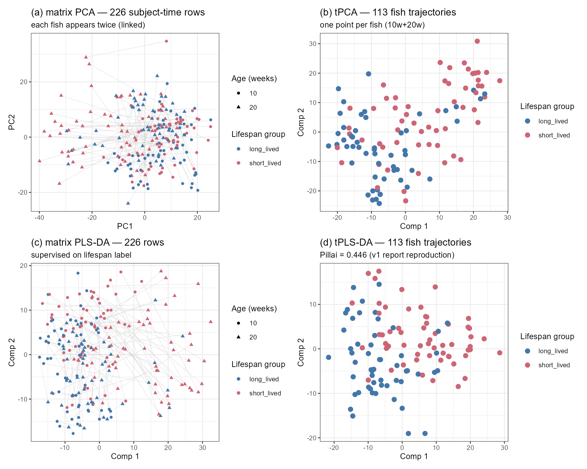

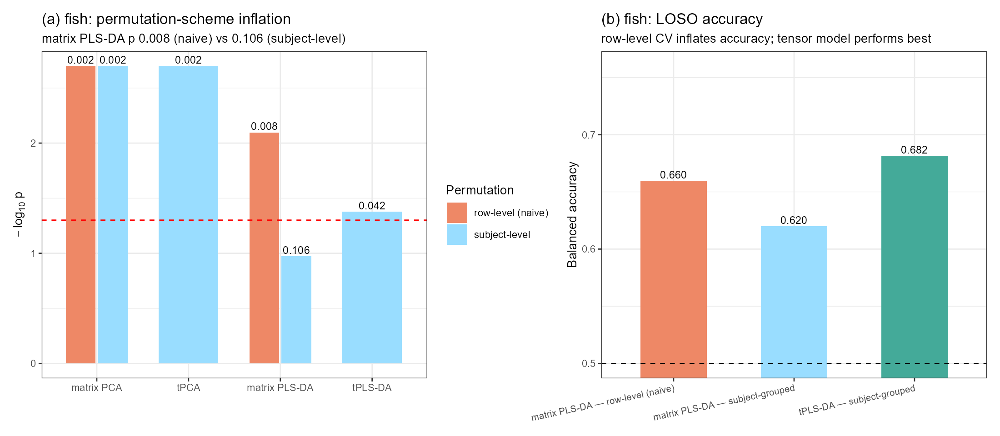

## 4.2 Reassessing the lifespan signal

The earlier draft described the signal as "connected to the 10-to-20-week trajectory". Two structure-preserving checks correct that statement (Figure FA2, Table 1):

- **Within-fish time reshuffle.** Swapping the two time points within each fish and refitting the whole pipeline does not reject the null (p = 0.150): the model performs nearly as well on temporally scrambled trajectories, so the data provide no evidence that the temporal ordering itself is required. This is an absence of evidence for a temporal-order effect rather than evidence that no dynamic component exists; with two time points and n = 113, a modest change-related contribution cannot be excluded. The audit model's subject-level label permutation, by contrast, gives p = 0.002 (R² statistic; Table 1), indicating that the observed lifespan association is unlikely to arise under label shuffling. The tPLS-DA permutation of Section 4.1 tests a different statistic (Pillai under refitting) and is not directly comparable.
- **Time-block ablation.** 10w only: R² = 0.329; 20w only: 0.488; 10w+20w: **0.541**; 10w+20w+delta: 0.505; delta only: 0.412.

On the available evidence the signal is best described as **level-based**: early-adulthood and 20-week expression levels jointly carry the lifespan information, and the 10→20-week change adds no unique contribution (two time points still beat one: 0.541 vs 0.488). A modest change-related contribution cannot be excluded at this sample size and with only two time points.

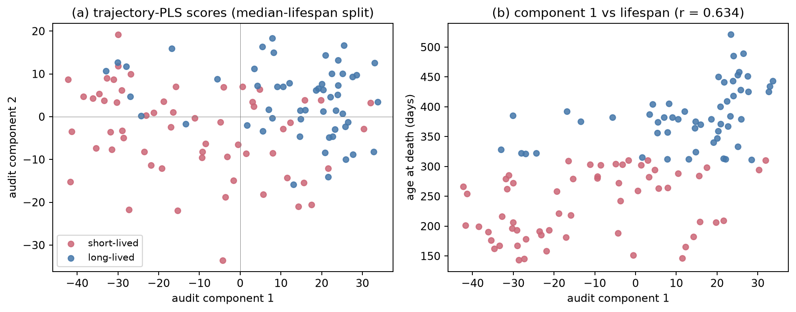

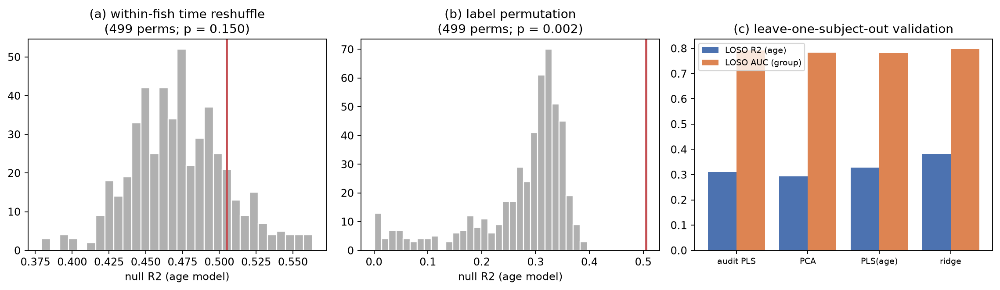

**Table 1. Fish main checks.**

| Analysis | Statistic | Value | p |
|---|---|---|---|
| tPLS-DA group test (reproduction) | Pillai | 0.446 | 7.7 × 10⁻¹⁵ |
| Label permutation, audit model (subject, 499) | R² | 0.505 | 0.002 |
| Label permutation, tPLS-DA (refit under permutation, 499) | Pillai | 0.446 | 0.042 |
| Time reshuffle (within-fish, 499) | R² | 0.505 | 0.150 |
| Continuous age, tPLS regression | R² (in-sample) | 0.566 | 0.005 (perm) |
| Continuous age, tPLS regression (fold-safe) | LOSO CV R² | −0.083 | — |
| Audit trajectory PLS, LOSO (fold-safe) | R² / AUC | 0.308 / 0.792 | — |
| Ridge baseline (flattened 3,000 features), LOSO (fold-safe) | R² / AUC | 0.380 / 0.797 | — |
| Bootstrap (fish) | R² 95% CI | [0.429, 0.661] | — |

The out-of-sample picture is consistent: in-sample R² ≈ 0.5–0.57 shrinks to ≈ 0.31 under grouped LOSO for the flattened audit model, and the two-component tensor regression does not generalise at all (LOSO R² = −0.083), even though held-out component scores still correlate with age (r = −0.405). A simple ridge regression on the flattened features matches or beats both. No predictive claim is warranted; the dataset supports a replicated association.

## 4.3 Annotation closure: a circadian module and a diffused complex I theme

The earlier report's largest interpretive gap — anonymous killifish gene identifiers — was closed by mapping the full gene build. The four bootstrap-stable genes are PAQR6, TUFT1A, COL10A1, and one identifier that remains unannotated even in the primary source; they rank 3rd, 17th, 25th and 479th of 26,739 genes by delta-age association. More importantly, the top loading genes include three core clock components (**PER1, NPAS2, NR1D1**), and the clock kinase CSNK1E ranks 15th in the top-50 delta-age FDR list; a targeted panel shows a coherent module: **7 of the 8 canonical clock genes are FDR-significant with consistent direction** (repressor arm NR1D1/CRY1/PER1/PER3 negative; activator arm NPAS2/ARNTL/CLOCK positive; Figure FA4a). In plain terms, the 10→20-week expression change is more negative for repressor-arm genes and more positive for activator-arm genes in longer-lived fish. These are rank correlations between the change and age at death: they describe a directional association of the change axis with lifespan, not absolute up- or down-regulation of individual genes, nor functional activation of the clock pathway. This change-oriented panel analysis is distinct from the level-based lifespan model of Section 4.2; the pattern connects to the aging–circadian literature and is reported as hypothesis-generating.

The mitochondrial complex I hypothesis was tested directly. All 41 annotated complex I genes were located; **0/41 survive into the 1000 most variable genes** (they are too stable to be selected), 21/41 (51.2%) show FDR-significant delta-age associations against a transcriptome-wide background of 32.0%, an enrichment of 1.60× (binomial p = 0.0083; median |rho| 0.235 vs 0.135, Mann-Whitney p = 0.0015). Overall the theme is directionally consistent but diffuse, and the original study's complex I claim is not recovered from these data alone.

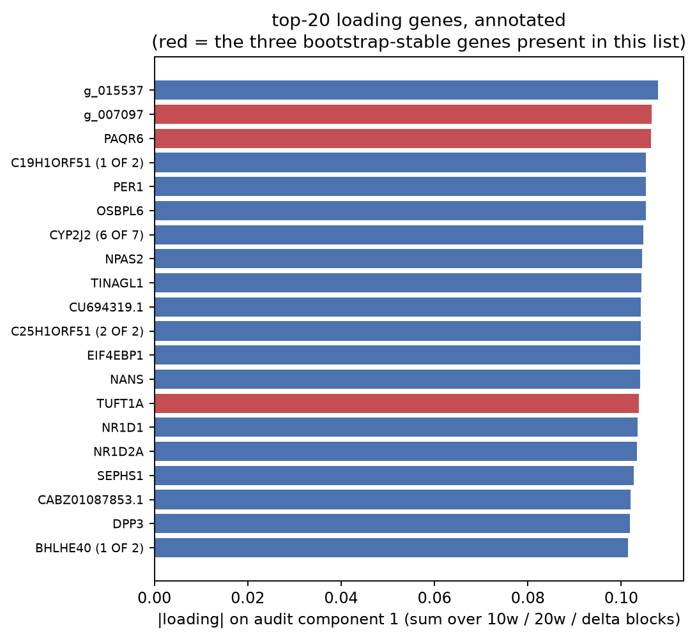

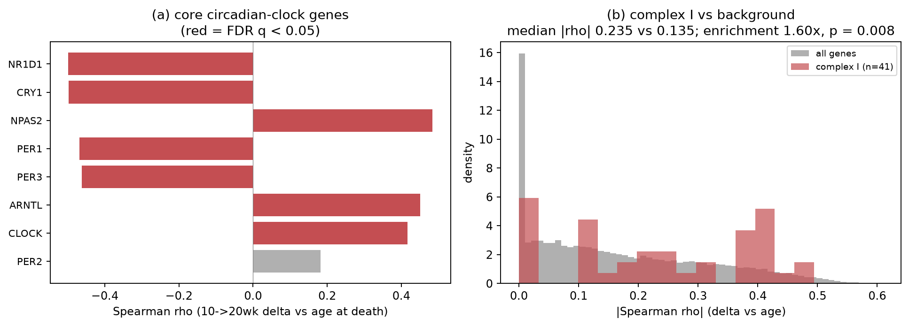

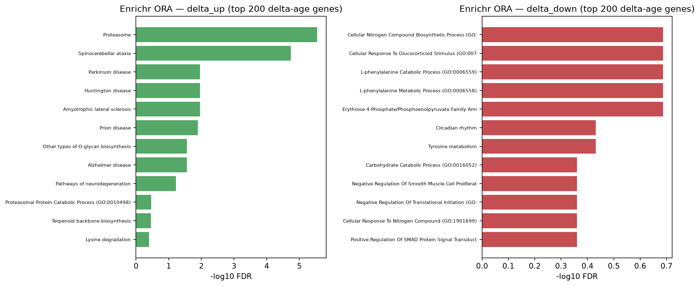

Pathway enrichment on the same axis (Figure FA5) finds the proteasome/ubiquitin axis up-regulated in longer-lived fish (KEGG Proteasome, FDR = 3 × 10⁻⁶); the delta-down direction passes no term. Gene-level FDR is diffuse (8,563/26,739 = 32.0% of genes at q < 0.05), so all conclusions are module-level statements, not gene discoveries.

## 4.4 Robustness and sensitivity

The lifespan model is insensitive to the feature threshold (in-sample R² at 2 components: 0.512 / 0.505 / 0.495 at 500 / 1,000 / 2,000 genes) and improves smoothly with up to four components (up to 0.63), with the caveat that more components mechanically raise in-sample fit. Bootstrap resampling over fish gives R² 95% CI [0.429, 0.661] and r(comp 1, age) CI [0.570, 0.753].

**Interim conclusion (fish).** Early fin transcriptome *levels* carry a reproducible, cohort-validated association with lifespan (in-sample R² ≈ 0.5, bootstrap CI excluding weak effects), organised in coherent modules (circadian clock; proteasome) rather than single genes; the 10→20-week change adds nothing; out-of-sample prediction is weak; and the complex I mechanism of the original study is not recovered. The association is validated *within* this cohort only; external validation is required for any predictive use.

# 5 Results: vaccine transcriptome (GSE79396)

## 5.1 Exact reproduction and the value of the tensor view

All earlier numbers were reproduced exactly (Section 3.2; component scores correlate 1.0000). Figure FV1 shows the central representational difference on this dataset (288 sample-time rows versus 72 subject trajectories, days 0/1/3/7). Figure FV2 quantifies the inference consequences: for the same matrix PLS-DA model, the naive row-level permutation gives p = 0.002 while subject-level permutation gives p = 0.094, and row-level LOSO reports balanced accuracy 0.722 versus 0.644 with subject grouping. The subject-grouped tensor model reaches 0.685, the best grouped accuracy in the comparison. Together these three numbers show that flattening is not merely cosmetic: it changes p-values by an order of magnitude and accuracy by ~8 points. Both grouped accuracies are robust to preprocessing provenance: re-deriving feature selection and scaling inside every training fold leaves the per-subject predictions unchanged.

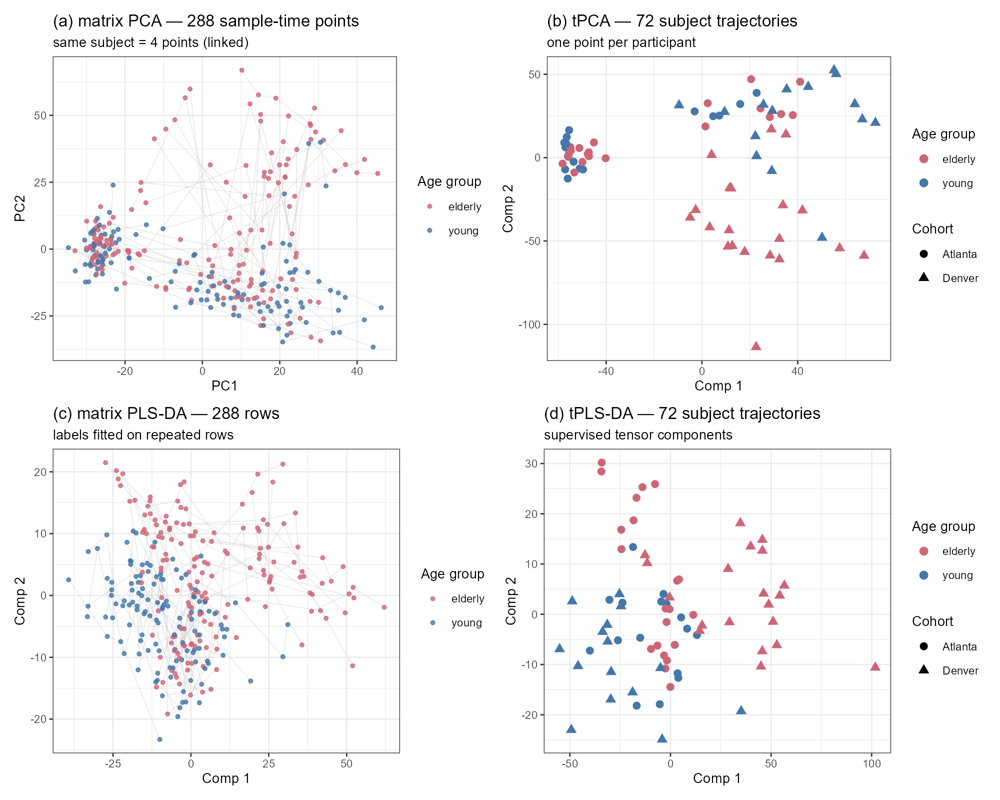

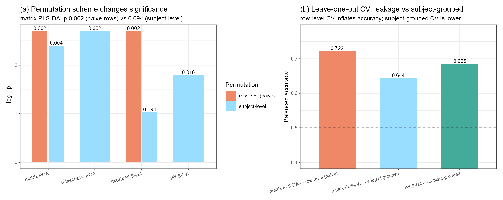

## 5.2 The batch workflow: from cohort to processing plate

The tensorOmics paper's case study 3 established the workflow "tPCA detects batch structure, PLSDA-batch corrects, biology re-emerges". Applied here, the audit pushed one level deeper than the available batch label (Figure FV3):

- **Cohort.** tPCA separates Atlanta from Denver (Pillai = 0.624, p = 2.3 × 10⁻¹⁵; η² = 0.49 on component 1). Cohort-level ComBat removes this structure (Pillai = 0.002, p = 0.93) and the unsupervised age association survives (permutation p = 0.003). Applying PLSDA-batch to the ComBat output — a layered correction rather than an independent replication — leaves the residual cohort structure equally low (η² ≈ 0.0002). At this point the analysis resembles the original report's conclusion.
- **Plate.** Extracting the processing-plate serials from the CEL file names revealed three plates nested within cohorts and strongly confounded with age (plate 8000000153: 11 young/13 elderly; 8000001652: 16/8; 8000013046: 4/20). The plate structure is the strongest technical factor in the tensor (tPCA Pillai = 1.45, p ≈ 1 × 10⁻³⁷, stronger than cohort), and because each subject's four visits sit on the same plate, it is invisible to cohort-level correction.
- **After plate-level correction** (ComBat with plate as batch, age/sex preserved): the age association of the transcriptome collapses — tPCA permutation p = 0.177 (from 0.003), five-component tPCA p = 0.57 (Pillai = 0.056), supervised tPLS-DA permutation p = 0.327. The non-destructive complement (age + plate + sex covariate adjustment of the original components) agrees for the unsupervised space (age MANOVA p = 0.295). Within the one plate that mixes cohorts and age groups (n = 24), the age test is also null (p = 0.158).

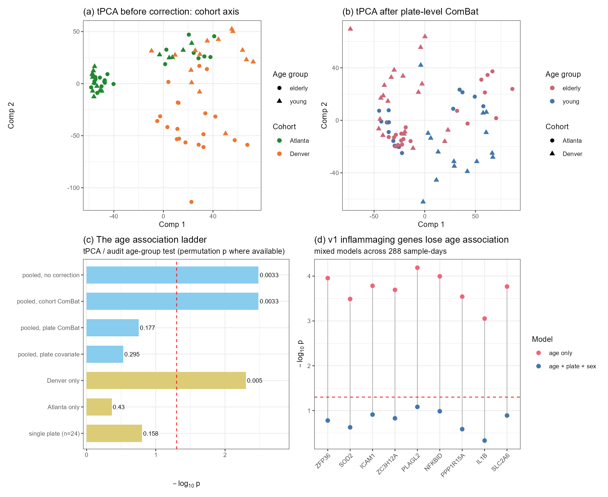

## 5.3 The age axis and its gene content do not survive

The earlier version of this report interpreted component 2 as an age-associated inflammaging axis, enriched for inflammatory, oxidative-stress and lipid/sterol terms. Exposed to the plate audit, that interpretation does not hold (Figure FV3d):

- All nine highlight genes (ZFP36, SOD2, ICAM1, ZC3H12A, PLAGL2, NFKBID, PPP1R15A, IL1B, SLC2A6) lose significance in mixed models with plate and sex (age-only p = 6.5 × 10⁻⁵–8.8 × 10⁻⁴; adjusted p = 0.083–0.466); effect sizes shrink 3–7× (e.g., ICAM1: β 0.91 → 0.28).
- No blood transcription module shows an age effect after plate adjustment (best raw p = 0.0055; FDR = 0.99 across 1,038 module–time combinations).
- The axis is also site-heterogeneous: within Denver the age association is strong (Pillai = 0.606, permutation p = 0.005; fold-safe LOSO balanced accuracy 0.78–0.79), within Atlanta it is absent (Pillai = 0.044, p = 0.43; fold-safe LOSO 0.41–0.52; 5-component check p = 0.91). The Denver signal follows its plate composition (20/24 elderly on one plate), so the between-site contrast is itself consistent with the plate explanation.
- A day-resolved axis score built from the supervised top-20 features shows a persistent age offset with no temporal dynamics (age p = 0.006 with plate/sex in the model; age × day interaction p = 0.68; 53% of the score's variance lies between subjects). Because the feature set was selected on the same data, this is descriptive rather than confirmatory.

**Conclusion for this dataset:** the apparent transcriptomic age axis of GSE79396 is not separable from processing-plate batch structure at n = 72. The pooled age signal, the inflammaging gene panel and the module-level associations must be treated as confounded; the defensible statements are negative and methodological.

## 5.4 Boundary analysis: response prediction and power

The earlier draft reported that response-level models (IgG day 30/0; CXCR3+ Tfh day 7/0) fitted in-sample but failed out of sample. The present analysis quantifies this boundary rather than only recording failure: with n = 72 the minimum detectable |r| at 80% power is 0.325; the observed correlations of the age axis with IgG day 30/0 are r = −0.126 (95% CI [−0.245, 0.244]) and with Tfh r = 0.081 (n = 34, CI [−0.343, 0.325]). The confidence intervals are wide and include moderate effects, so the correct statement is "this design cannot exclude a moderate response association" rather than "no association exists". Combined with the batch findings, no response-prediction claim is supportable.

# 6 Results: multi-block integration (transcriptome–metabolome)

To exercise the framework's multi-omic capabilities, the vaccine transcriptome was integrated with the study's own subject-level metabolomics, restricted to the matching days 0/1/3/7 and 72 subjects (top 500 transcriptome features; top 250 positive-mode and 250 negative-mode metabolites by variance; features z-scored). Figure FV4 summarises the results.

- **Unsupervised integration (tPLS canonical).** A strong shared axis links the two blocks: the subject scores of component 1 correlate at r = 0.833 (pairing permutation p = 0.01), component 2 at r = 0.658.
- **Supervised integration (block.tPLS-DA, three blocks).** The transcriptome block separates age groups (Pillai = 0.165, p = 0.002; permutation p = 0.010); the metabolite blocks are weaker (p = 0.16 and 0.053).
- **The batch lens applies to integration too.** Alignment analysis shows the shared axis tracks plate structure (transcriptome-side plate Pillai = 1.53, p ≈ 3 × 10⁻⁴²; metabolome-side plate Pillai = 1.18) and cohort (0.61 / 0.75) far more than age (0.165 / 0.076). With the transcriptome plate-corrected, the shared-axis correlation falls from 0.833 to 0.444 and the corrected axis aligns with none of the labels (age p = 0.88, cohort p = 0.09, plate p = 0.93). The metabolite block itself shows the same hierarchy (cohort p = 2.8 × 10⁻¹⁵; plate p = 4.3 × 10⁻¹²; age p = 0.169).
- The cross-layer correlation structure (top 30 × 30 feature pairs per time point; Figure FV4c) is available as data for the report; its strongest components reflect the coordinated technical/cohort structure rather than age biology.

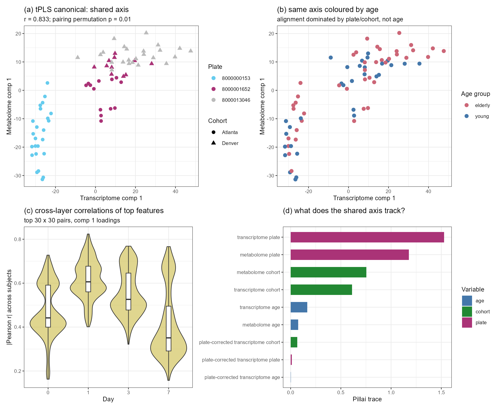

The multi-block machinery works: it finds the strongest coordinated variation across molecular layers, and the audit layer identifies that variation. On this dataset the coordinated axis is technical; the demonstration is nonetheless the clearest multi-omic capability shown in this report, and it extends the framework's published case studies to a transcriptome–metabolome pair analysed with an explicit batch audit.

# 7 Discussion

## 7.1 Contributions of the tensor view

1. **The correct unit of analysis, with measurable consequences.** The subject-level representation is not cosmetic: with identical data and models, naive repeated-measures protocols inflated permutation significance by 13–47× (fish 0.008→0.106; vaccine 0.002→0.094) and cross-validated accuracy by 4–8 percentage points. In both datasets the subject-grouped tensor model gave the best grouped accuracy (vaccine 0.685; fish 0.682 vs matrix-grouped 0.620 and leaking naive 0.660), while a simple ridge on flattened fish features remained the strongest continuous-outcome predictor (LOSO R² = 0.380). The advantage is inferential correctness and accuracy measured on the correct unit, not universal predictive superiority.
2. **Detection workflows that matrix views hide.** tPCA exposed batch structure in two nested layers (cohort, then processing plate), reproducing and extending the methods paper's Appendix B workflow. The extension matters: a biological variable can be imbalanced at a finer batch level than the obvious label (here: age vs plate), and only the tensor decomposition made this visible at the level of individual subjects. Had the analysis stopped at cohort-level adjustment, the original (confounded) conclusion would have stood.
3. **Multi-omic integration over time.** tPLS canonical and block.tPLS-DA integrate layers while preserving trajectories, producing subject-level shared scores and interpretable loadings. Their output on this dataset is a strong shared axis (r = 0.83) that the audit layer assigns to technical structure — a result that showcases both the machinery and the necessity of the audit.

## 7.2 Limits of the tensor view

- **Pseudo-replication is an inference problem.** The tensor representation removes the temptation, but the same protection is available to matrix analyses through subject-level permutation and grouped CV. What tensor methods provide is the natural *default*: one point per subject.
- **Batch confounding must be audited at the finest level.** Tensor decomposition made the plate structure visible, but its removal was a standard matrix operation (ComBat); and the confound was only detectable because plate information could be recovered from raw CEL names — a reminder that preprocessing provenance is part of the analysis.
- **Small n and annotation limits remain.** The vaccine dataset cannot adjudicate the age question (its age signal is inseparable from batch; its response associations are underpowered at |r| < 0.33). The fish dataset is two time points only — the minimal tensor case — and its gene-level conclusions are module-level at best.

## 7.3 Biological interpretation

- **Killifish.** Early-adult and 20-week fin transcriptome *levels* carry a replicated association with lifespan (in-sample R² ≈ 0.5; bootstrap CI [0.43, 0.66]); the association is organised in coherent modules — a circadian-clock axis with direction-consistent effects in 7/8 core clock genes, and a proteasome/ubiquitin axis — rather than in the mitochondrial complex I theme of the original study, which is recovered only diffusely (1.60× enrichment). The dataset does not support prediction or mechanism claims.
- **Vaccine.** The transcriptomic age axis of GSE79396 is not separable from processing-plate batch at n = 72. Neither the inflammaging gene panel nor the BTM modules survive plate adjustment; the within-site heterogeneity pattern is consistent with the plate explanation. The originally reported systems-vaccinology biology [5] rests on a broader multi-assay design than this GEO matrix; nothing in the present reanalysis supports or refutes the study's integrated conclusions, but it does show that the transcriptomic age axis alone cannot carry them.

## 7.4 A validation protocol for tensorOmics applications

**Table 2. Recommended checks when applying tensorOmics.**

| # | Check | Implementation used here |
|---|---|---|
| 1 | Reproduce any prior pipeline exactly | Correlations = 1.0000 on component scores |
| 2 | Permute at the subject level; report the naive scheme for contrast | Refit under permuted labels; report both p-values |
| 3 | For trajectory claims, permute time within subject | Fish time reshuffle (p = 0.150) |
| 4 | Cross-validate by leaving out subjects; never rows | Manual verified projection; grouped LOSO |
| 5 | Audit *nested* batch structure; correct at the finest level; replicate within batch | Cohort → plate; ComBat; within-plate test |
| 6 | Report robustness grids, bootstrap CIs, multiplicity control and a minimum detectable effect | Sensitivity; bootstrap; family-level FDR; MDE = 0.325 |

## 7.5 Corrections relative to the first report

This report supersedes three statements of the earlier draft: (i) the fish signal is level-based, not trajectory-based (Section 4.2); (ii) the vaccine age axis and its inflammaging gene panel are confounded with processing plate and are withdrawn as biological claims (Sections 5.2–5.3); (iii) response-level models are better described as underpowered than as failures (Section 5.4). These corrections are the direct product of the audit layer and illustrate its purpose.

## 7.6 Limitations

Both datasets are analysed complete-case. The fish tensor is minimal (two time points), so tensor-specific advantages over well-conducted matrix analyses are modest there. The vaccine dataset is small (n = 72), has one dominant technical confound, and only partial supplement coverage for immune outcomes (Tfh n = 34). Metabolite features are largely unidentified m/z–retention-time pairs, limiting biological interpretation of the multi-block axis. The plate structure was recovered from CEL file names rather than from curated metadata; while the pattern is unambiguous, the analysis would have been cleaner with an explicit batch field. The validation protocol itself (Section 3.4) is designed for complete, matched designs; irregular sampling requires the interpolation strategies discussed by the methods paper [1]. Multiplicity was handled within each analysis's natural family using the Benjamini-Hochberg procedure; applied to the stored statistics it leaves every reported conclusion unchanged (individual gene-level calls inside the exploratory joint reference families can shift at the threshold, without affecting any reported conclusion). Families whose composition follows a display table rather than a hypothesis — the scheme-comparison panel, the per-component summaries, the block-level statistics of Section 6 — remain exploratory and are treated as descriptive. Fold-safe re-derivations were completed for the killifish classification, baseline and regression models, for the pooled vaccine LOSO, and for the within-cohort checks; deviations from the committed values are documented in the repository's validation record, and the fold-safe values are those cited in Sections 4 and 5.3.

# 8 Conclusion

Tensor-aware analysis is best read as a representation and workflow layer rather than a replacement for matrix methods: it puts the subject at the centre of the score plot, makes repeated-measures inference the default, exposes nested technical structure, and enables multi-omic integration over time. On the two datasets analysed here, that layer (a) quantified two classical illusions — pseudo-replication and batch confounding — that the earlier analysis had partly absorbed, (b) supported a corrected and defensible biological conclusion in the killifish data (a level-based, module-organised, replicated lifespan association), and (c) converted a previously positive but confounded vaccine result into a methodological case study. The most useful outcome for future work is the validation protocol of Section 3.4: six checks that are cheap to run, applicable to any tensorOmics application, and able to separate exploratory structure from defensible evidence.

# Code and reporting note

All analyses were run locally with seeds fixed: the revision-stage scripts live in `TER_revision/scripts/` and the killifish optimisation stage ("Task A") in `fish_v2_src/ter_optimization/scripts/`; Appendix A maps each results block to its producing scripts and stored result files. Most numbers are stored as files under `results/tables/` or the fish-stage results directory; a small number of diagnostic values exist only as console output at the time of writing. Fish tensor analyses are performed with the official R `tensorOmics` package plus a Python audit pipeline (scikit-learn); vaccine analyses use the official R package, mixOmics, sva and PLSDAbatch, with a verified manual projection for held-out subject prediction. Code implementation, language polishing, report organisation and code review were carried out with AI assistance under the author's direction (the fish optimisation stage used the ClawsGO Science Harness; the revision stage used a local coding agent). All numerical values come from the executed scripts; most are also stored as result files, and the few that exist only as console output are flagged in the audit log. The analysis of the killifish dataset builds on the earlier optimisation stage of the internship ("Task A"), which has been re-executed and verified in this workspace before inclusion.

# Appendix A. Traceability of reported numbers

All numbers in this report were produced by the scripts in `TER_revision/scripts/` (fish optimisation stage: `fish_v2_src/ter_optimization/scripts/`); results blocks are stored under `TER_revision/results/tables/` and `fish_v2_src/ter_optimization/results/`, as mapped below. A few diagnostic values exist only as console output and are not stored as files.

| Report item | Main scripts | Result files |
|---|---|---|
| Fish reproduction, permutation, LOSO, bootstrap, sensitivity, gene FDR | `03_fish_analysis.py` | `TA_summary.json`, `TA_loso_cv.csv`, `TA_sensitivity.csv`, `TA_gene_fdr.csv.gz` |
| Fish annotation, complex I, circadian panel | `01_parse_gff.py`, `04_annotate_hits.py` | `gene_annotation.tsv`, `TA_top_loadings_annotated.csv`, `TA_complexI_members.csv`, `TA_circadian_genes.csv`, `TA_enrichment_summary.json` |
| Fish time-block ablation | `06_ablation.py` | `TA_ablation.csv` |
| Fish GSEA (Enrichr) | `05_fish_figures_gsea.py` | `TA_gsea_enrichr.csv` |
| Fish matrix-vs-tensor comparison, permutation inflation, LOSO | `07_fish_comparison.R`, `07b_fish_scores_fix.R`, `07c_fish_tplsda_loo.R` | `fish_manova.csv`, `fish_perm_inflation.csv`, `fish_loso_naive_vs_grouped.csv`, `fish_scores_row.csv`, `fish_scores_subject.csv` |
| Fish tPLS regression (in-sample, permutation, LOSO) | `08_fish_tpls_regression.R` | `fish_tpls_regression.csv` |
| Vaccine data preparation and v1 exact reproduction | `10_prepare_gse79396.R`, `11_reproduce_v1.R` | `repro_v1_check.txt`, `vaccine_data.rds` |
| Vaccine value-proposition: MANOVA, permutation inflation, LOSO | `20_vaccine_valueprop.R` | `vacc_manova.csv`, `vacc_perm_inflation.csv`, `vacc_loso.csv`, `vacc_scores_row.csv`, `vacc_scores_subject.csv` |
| Vaccine batch workflow (cohort, plate, within-site, 5-component checks) | `21_vaccine_batch.R`, `21b–21d` | `vacc_batch_metrics.csv`, `vacc_within_cohort.csv`, `vacc_heterogeneity_comps.csv`, `vacc_chip_correction.csv`, `vacc_chip_adjustment.csv`, `vacc_chip_tpca5.txt` |
| Vaccine gene panel, BTM modules, axis dynamics, response boundary | `22_vaccine_deep.R`, `22b_baseline_dynamics.R` | `vacc_v1genes_chip_adjust.csv`, `vacc_btm_age_chip.csv`, `vacc_axis_dynamics_anova.csv`, `vacc_boundary.csv`, `vacc_mde.txt` |
| Multi-block integration (canonical, block.tPLS-DA, cross-layer, chip sensitivity) | `30_vaccine_multiblock.R`, `30b_multiblock_corrected_align.R` | `vacc_multiblock_canonical.csv`, `vacc_multiblock_align.csv`, `vacc_multiblock_blocktplsda.csv`, `vacc_multiblock_crosslayer.csv`, `vacc_multiblock_scores.csv` |
| Figures | `40_vaccine_figures.R`, `41_fish_figures.R` | `results/figures/FV1–FV4`, `FF1–FF2`, `FA1–FA5` |

# References

[1] Kodikara S, Lu B, Wang S, Lê Cao K-A. tensorOmics: Data integration for longitudinal omics data using tensor factorisation. bioRxiv. 2026. doi:10.64898/2026.02.10.705179.

[2] Mor U, Cohen Y, Valdes-Mas R, Kviatcovsky D, Elinav E, Avron H. Dimensionality reduction of longitudinal omics data using modern tensor factorizations. PLOS Computational Biology. 2022;18(7):e1010212. doi:10.1371/journal.pcbi.1010212.

[3] Rohart F, Gautier B, Singh A, Lê Cao K-A. mixOmics: An R package for omics feature selection and multiple data integration. PLOS Computational Biology. 2017;13(11):e1005752. doi:10.1371/journal.pcbi.1005752.

[4] Baumgart M, Priebe S, Groth M, Hartmann N, Menzel U, Pandolfini L, et al. Longitudinal RNA-Seq analysis of vertebrate aging identifies mitochondrial complex I as a small-molecule-sensitive modifier of lifespan. Cell Systems. 2016;2(2):122–132. doi:10.1016/j.cels.2016.01.014.

[5] Li S, Sullivan NL, Rouphael N, Yu T, Banton S, Maddur MS, et al. Metabolic phenotypes of response to vaccination in humans. Cell. 2017;169(5):862–877.e17. doi:10.1016/j.cell.2017.04.026.

[6] Johnson WE, Li C, Rabinovic A. Adjusting batch effects in microarray expression data using empirical Bayes methods. Biostatistics. 2007;8(1):118–127. doi:10.1093/biostatistics/kxj037.

[7] Wang Y, Lê Cao K-A. PLSDA-batch: a multivariate framework to correct for batch effects in microbiome data. Briefings in Bioinformatics. 2023;24(2):bbac622. doi:10.1093/bib/bbac622.
